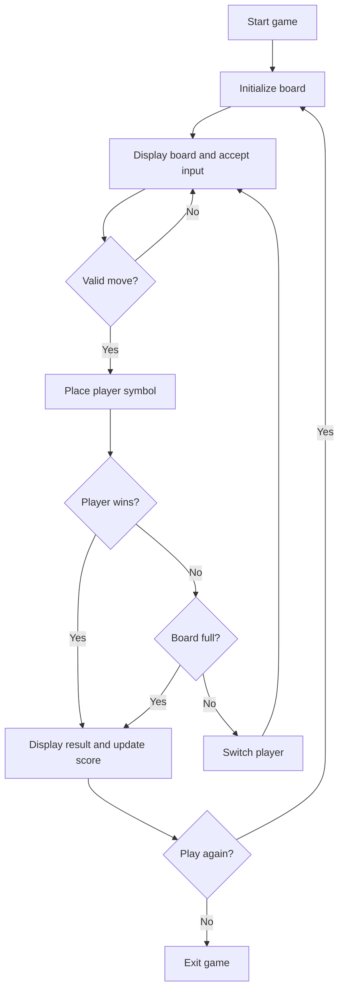

🎮 Tic Tac Toe — Java Console Game
A colorful, interactive, two-player Tic Tac Toe game built using Core Java. The application runs in the console and provides a formatted game board, input validation, automatic winner detection, score tracking, and a replay option.

✨ Features
- Local two-player gameplay (X and O).
- Colorful console output using ANSI escape codes.
- Formatted 3 × 3 board with row and column indices.
- Automatic player switching after valid moves.
- Validation of non-numeric input, invalid coordinates, and occupied cells.
- Winner detection across rows, columns, and diagonals.
- Automatic draw detection.
- Scoreboard tracking X wins, O wins, and draws during the current session.
- Replay option without restarting the application.
🛠️ Technologies Used
Technology	Purpose
Java	Game logic and application development
Scanner	Console input handling
Two-dimensional character array	Game board storage
ANSI escape codes	Colored console output
Eclipse IDE (optional)	Development and execution

📁 Project Structure
Example layout for an Eclipse Java project:
TicTacToe/
├── src/
│   └── console_based_application/
│       └── TicTacToe.java
└── README.md
🚀 Getting Started
Prerequisites
- Java Development Kit (JDK) installed.
- Eclipse, VS Code, or a terminal with Java configured.
- An ANSI-compatible terminal and UTF-8 encoding for colors and Unicode board borders.
Run using Eclipse
1. Create or open a Java project.
2. Create the package console_based_application inside the src folder.
3. Add TicTacToe.java to the package.
4. Right-click the class and select Run As → Java Application.
If ANSI escape codes appear as raw text, use an ANSI-compatible terminal or install a compatible ANSI console extension in Eclipse.
Run using the terminal
From the project root, assuming the source layout shown above:
javac -encoding UTF-8 -d out src/console_based_application/TicTacToe.java
java -cp out console_based_application.TicTacToe
🕹️ How to Play
1. Player X starts the game.
2. Enter a row index and a column index between 0 and 2.
3. Select an empty cell to place your symbol.
4. Player O takes the next turn.
5. The first player to match three symbols horizontally, vertically, or diagonally wins.
6. If all cells are occupied and nobody wins, the game ends in a draw.
7. Enter Y to play again or N to exit.
🖥️ Sample Console Output
Illustrative output (colors are visible in a supported terminal):
╔══════════════════════════════════╗
║          TIC TAC TOE GAME        ║
║          JAVA CONSOLE GAME       ║
╚══════════════════════════════════╝

Player 1 : X
Player 2 : O

        0     1     2
     ┌─────┬─────┬─────┐
  0  │  X  │  O  │     │
     ├─────┼─────┼─────┤
  1  │     │  X  │  O  │
     ├─────┼─────┼─────┤
  2  │     │     │  X  │
     └─────┴─────┴─────┘

====================================
  CONGRATULATIONS! PLAYER X WINS!
====================================

╔══════════════════════════╗
║        SCORE BOARD       ║
╠══════════════════════════╣
║ Player X Wins : 1        ║
║ Player O Wins : 0        ║
║ Match Draws   : 0        ║
╚══════════════════════════╝

Do you want to play again? (Y/N):
🎨 Color Scheme
Color	Usage
Cyan	Player X and board borders
Magenta	Player O
Green	Winning message
Red	Invalid input and moves
Yellow	Instructions, prompts, and draw messages
White	Column indices and draw statistics

⚙️ Important Methods
Method	Responsibility
main()	Controls the application and replay loop
printBanner()	Displays the title and instructions
initializeBoard()	Resets all board cells
playGame()	Manages the game loop
readInput()	Validates numeric input
isValidMove()	Checks coordinates and cell availability
switchPlayer()	Alternates between X and O
isPlayerWin()	Checks all eight winning combinations
isBoardFull()	Checks whether empty cells remain
getColoredSymbol()	Applies colors to player symbols
printBoard()	Displays the formatted board
printScoreBoard()	Displays session statistics

🔄 Game Flow

📚 Java Concepts Demonstrated
- Classes and static methods
- Two-dimensional arrays
- Nested loops and conditional statements
- Ternary operator
- Constants using static final
- Input validation and method decomposition
- String formatting and ANSI escape sequences
🔮 Future Enhancements
- [ ] Single-player mode against a computer using Minimax.
- [ ] Custom player names.
- [ ] Highlight winning cells.
- [ ] Persistent score history using file handling.
- [ ] Refactor into an object-oriented design with separate Player, Board, and Game classes.
- [ ] Add a graphical interface using JavaFX or Swing.
🤝 Contributions
Suggestions and improvements are welcome. Fork the repository, create a feature branch, and submit a pull request.
⭐ If you find this project useful, consider starring the repository.
